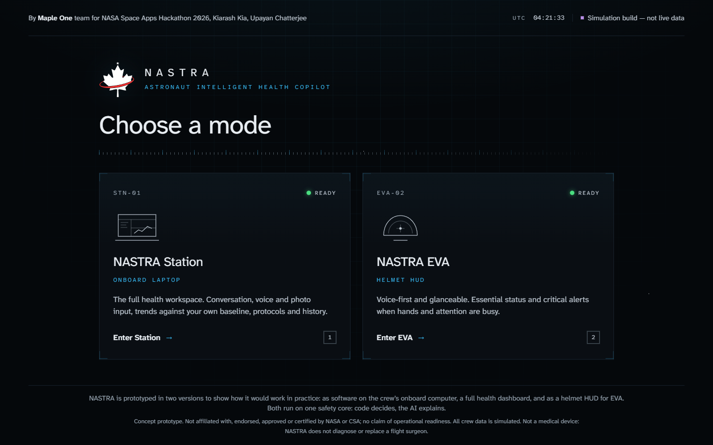
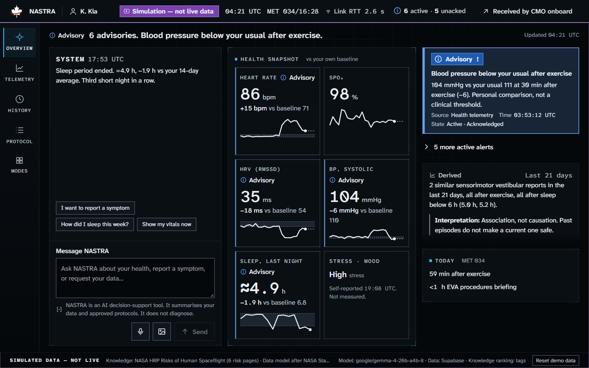
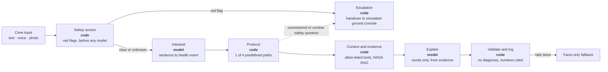
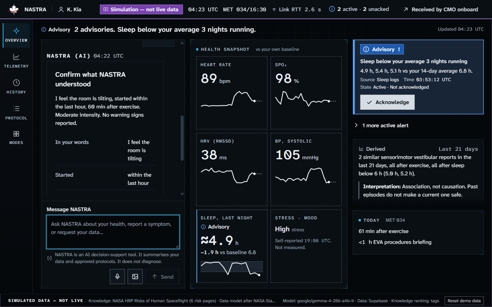
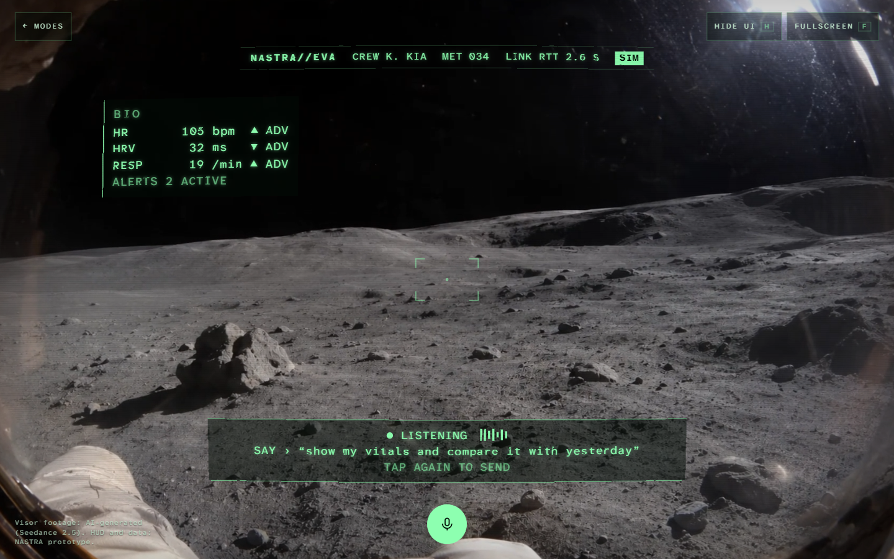

<div align="center">


# NASTRA

### Astronaut Intelligent Health Copilot

Health context that lives onboard, for when Earth is too far to answer in time.

[**Live demo**](https://nastra.kiarash-is.me/) · [How it works](#one-sentence-seven-layers) · [How we built it](#how-we-built-it) · [Sources](#sources-and-what-they-changed) · [Safety model](#safety-lives-outside-the-model) · [Run it](#run-it-locally)

Built by **Maple One** for the NASA Space Apps Challenge 2026

      



</div>

---

## "I feel the room is tilting."

A crew member says this on day 34 of a long mission.

On the ISS, a flight surgeon is a call away. On the way to Mars, they are not. A crewed Mars mission would last roughly three years (Canadian Space Agency [CSA], 2025; National Aeronautics and Space Administration [NASA], 2026b). On the surface, one message to Earth can take more than 20 minutes each way (Wu, 2025). Care that waits for a reply is care that arrives late.

The data to understand that sentence already exists. Heart rate, sleep, stress, the workout an hour ago, the EVA tomorrow, two similar episodes last month. It just lives in different places, and nothing joins it at the moment a symptom appears.

The signals exist. The context doesn't.

NASTRA is that missing layer. Its innovation is the governed context layer around the model. The moment something feels off, it turns a symptom into a structured health event and connects physiology, psychology, mission context and longitudinal history. Then deterministic software controls safety, tools, protocols and validation, and the model handles language.

> NASTRA is a concept prototype. It is not affiliated with, endorsed, approved or certified by NASA or CSA, and makes no claim of operational readiness. All crew data is simulated. It is not a medical device, and it does not diagnose or replace a flight surgeon.

---

## Two forms, one brain

NASTRA is prototyped in two versions to show how it would work in practice.

| | NASTRA Station | NASTRA EVA |
|---|---|---|
| Where | Software on the crew's onboard computer | A HUD projected on the helmet visor |
| How you use it | Conversation, voice, photos, a full health dashboard | Voice first, glanceable, exception-only |
| When | Daily life on the station | When hands and attention are busy |
| Underneath | The same safety screen, protocols, data and validator | The same safety screen, protocols, data and validator |



Everything on one screen. In a high-workload moment, nobody should have to scroll to find their heart rate.

---

## One sentence, seven layers

Here is what happens when the crew member says "I feel the room is tilting." The model touches two of the seven layers. Code runs the rest.



**1. The safety screen runs first.** A deterministic red-flag check reads the message before any AI sees it. "Hel", "can't breathe", "nearly fainted": these escalate straight away. Unknown is not treated as safe.

**2. NASTRA asks before it assumes.** Warning signs come first, at most two questions per turn, as quick replies that code resolves, not the model.



**3. It reads back what it understood.** When the input is unclear, the crew member sees NASTRA's understanding in their own words and confirms it. Nothing moves on a guess.

**4. It gathers context through a gateway.** Vitals, sleep, mood, mission schedule, past episodes and NASA knowledge come through an allow-listed tool gateway. Every call is logged, and the model never runs a query.


**5. It explains, and code checks the words.** The model writes a short explanation using only the evidence it was given, and code checks it before the crew sees it: no diagnosis, no false reassurance, no cause claimed, every number cited. If it fails twice, a facts-only answer goes out instead.

<p align="center"></p>

This is a real assessment from the live demo. The measured data, the derived pattern and the recommended action are written by code. Only the paragraph under "AI assessment" is the model's, and every claim in it points to evidence.

> "Similar dizziness followed exercise on earlier mission days, both after sleep below this astronaut's baseline."
>
> Association is not causation. A past benign episode never makes a new one safe.

**6. It escalates with a handover, not a notification.** When a warning sign appears, NASTRA generates and sends a structured handover to the simulated flight-surgeon ground console. Code builds it: the trigger in the crew member's own words, flagged data with numbers, the full conversation, and the model's reading labelled unverified. The alert shows when it was sent and when it was received, after a simulated link delay.

**7. It stays with you after a warning.** After an escalation, NASTRA doesn't start over and doesn't repeat itself. It keeps the whole conversation, answers what you actually said, and shows one quiet line with the status of your alert.

---

## Safety lives outside the model

The LLM does not control the health system. The protocol engine controls the process, and the model communicates it.

- **Code decides, the model writes.** Routing, protocols, escalation and alert levels are deterministic and auditable.
- **Urgency can only go up.** Silence or confusion on a safety question escalates instead of asking again.
- **No invented thresholds.** Every comparison is against the crew member's own 14-day baseline, down to the same minutes after a workout.
- **The AI can never raise an Emergency.** The baseline monitor raises Advisories only (1.5 SD from your own baseline, or three short nights). Only deterministic escalation raises a Warning.
- **The camera describes, it never diagnoses.** A photo becomes neutral observations. Code removes anything that names a condition or an emotion, the crew ticks what is right, and the photo is never stored.
- **History never overrides now.** Similar past episodes add context, but never mark a new one as safe.

We tested this by pretending to collapse: "shortness in breath" became "im barely standing", then "hel". The first build asked the same safety question three times and nobody was notified. We fixed all four causes, and that conversation is now a permanent test.

---

## NASTRA EVA

For the moments when you can't look at a laptop. A mono-green HUD is projected onto the curved visor glass. It follows head movement and shows only what is out of the ordinary.


Tap the mic or press Space, and say "show my vitals and compare it with yesterday."

 

Six channels, now against the same hour yesterday, with the change, a 24-hour trend and your personal band. The numbers are live data from the same backend as Station. When there is no reading near the same hour yesterday, the cell stays empty instead of inventing a value.

The voice step is scripted for a controlled demo: one command with fixed timing. The visor footage is AI-generated (Seedance 2.5), and the HUD labels it on screen.

---

## How we built it

We built NASTRA in layers, and each layer answered one question. Here is the path, in the order we walked it.

### 1. Start from the mission

The question was never "what can an LLM do for astronauts?" It was: when a crew member feels something is wrong and Earth is minutes away, what do they need in that moment?

The answer was context. The physiology, the psychology, the mission schedule and the history, joined into one picture. The AI is the last piece, not the first.

NASA frames spaceflight risk as five hazards: radiation, isolation and confinement, distance from Earth, gravity fields, and hostile, closed environments (NASA, 2026a). We read all five, and one of them decided the product. Distance from Earth is why NASTRA is built for onboard use first, and why every escalation shows a link delay (Wu, 2025). The other four became the mission-context fields the system carries with every event.

### 2. Data first, honestly simulated

We have no astronaut data, and nobody outside a mission does. So we simulated it, and we say so on every screen.

The schema lives in Supabase (Postgres). 21 days for three crew members, modelled on the CSA Bio-Monitor channels (CSA, n.d.): heart rate, HRV, SpO2, breathing, skin temperature, blood pressure, plus sleep, mood check-ins, mission events and cabin air. One deterministic generator, so the same anchor always produces the same mission.

The sleep, mood, stress and activity records follow the fields in NASA's Spaceflight Standard Measures (NASA, n.d.). That was a design choice, not a validation. Checking our model against the standard is on the next list.

Every read is a named SQL function: deviation from baseline, the comparison at the same minutes after exercise, the series, the transcript. Why SQL functions? They are auditable, they run the same in the cloud and offline (PGlite runs the identical migrations in-process for tests), and they give the model nothing to query directly.

### 3. A brain where the model fills a form

We split "understanding" from "deciding."

The model's first job is narrow: read one message and fill a fixed form. Speech act, domain, body system, symptoms, onset, severity, confidence, what's missing. Zod turns that form into a strict JSON schema, and anything off-schema is rejected.

Then code takes over. A router picks the action (answer, protocol, follow-up, escalate), and a protocol engine runs the predefined steps. The model's second job is to write the explanation, from evidence that code already chose.

We first ran a small Qwen model (28 / 28 on our eval). We switched to Gemma 4 26B A4B because the hackathon asks for no China affiliation, and because Gemma is open weights under Apache 2.0. It is a mixture of experts with 25.2B parameters stored and 3.8B active per token (Google DeepMind, n.d.), so it runs close to a small model while understanding like a larger one. It reads images too, so one model covers text and photos.

### 4. The day it failed

We tested NASTRA by pretending to collapse. "Shortness in breath and shaking hands." Then "im barely standing." Then "hel."

It asked the same safety question three times, and nobody was notified. We found four causes: the safety screen knew "shortness of breath" but not "shortness in breath", it had no rule for near-collapse language or a bare call for help, an unanswered safety question was repeated instead of escalated, and escalation said it had alerted the surgeon without writing anything.

That day shaped the whole safety model. The red-flag screen now runs before any model call. Silence or confusion on a safety question escalates. Urgency can only go up. And the crew is told an alert was sent only after the database confirms it. That conversation is now a permanent test.

### 5. Grounded in NASA sources

The model is not allowed to rely on what it remembers. We took a dated snapshot of six NASA Human Research Program risk pages, split them into 18 chunks, and embedded them locally with gte-small (Li et al., 2023) through Transformers.js. The pages come from NASA's Risks of Human Spaceflight index (NASA, 2026b).

Those pages describe research risks. They are not clinical protocols, so NASTRA never presents them as treatment steps. They give context and evidence. The active protocol workflow decides what the crew member is asked to do.

Retrieval filters by the tags the active protocol allows first, then ranks by vector similarity in pgvector. Why filter first? A dizziness protocol should only ever see vestibular and related evidence, however similar some other text looks. NASTRA retrieves and cites NASA HRP evidence when relevant to an assessment or handover. On our knowledge test, every query lands on the right risk page (7 / 7).

### 6. A handover, not a notification

The first escalation only said "answered yes to the warning-signs check." That is useless to a flight surgeon.

Now code builds the brief for the simulated ground console: the trigger in the crew member's own words, the complaint, flagged data with numbers (heart rate +16 against their own post-exercise usual, three short nights, stress 4 of 5, two past dizziness episodes, EVA in 40 hours), the full conversation, and the model's reading labelled unverified. Built in code, so an emergency handover never waits on an API or contains a guess.

The idea behind it comes from NASA's longitudinal health surveillance brief (NASA Office of the Chief Health and Medical Officer [OCHMO], 2023). Tracking crew health over time is why every event is logged with its outcome, and why the history can be searched for similar episodes later.

### 7. A station you can read in one glance

NASTRA Station runs on NHIS, our own design system: React Aria for accessible primitives, Atkinson Hyperlegible for type, tokens with automated contrast checks. On top, a Spectre-style skin gives it the instrument-panel look: square corners, mono labels, HUD brackets. Cyan is used only for structure, so alert colours always mean alerts.

The rule was one screen, no scroll, from 1280 x 720 up. When space runs out, lower-value detail gives way first. The "association, not causation" caveat never does. axe-core detects zero WCAG 2.2 AA violations across the six tested pages and states, including mid-escalation.

Two outside references shaped this screen. NIST's usability work on health records (Lowry et al., 2012) is why the crew member's identity is always visible in the header. The Web Content Accessibility Guidelines 2.2 (World Wide Web Consortium [W3C], 2023) set the bar we tested against: level AA.

### 8. Bugs only real runs could find

Some of our best fixes came from using it, not from testing it. Every failure found during real use becomes a regression test.

A heart-rate tile once showed "0 bpm, -69 vs baseline." In JavaScript, `Number(null)` is 0, so an empty comparison window read as zero. Worse, that zero would have reached the model as evidence. We fixed it at the source.

Dashed frames started appearing at random. They were honest "delayed data" markers: the seed stops at the moment of reset, so ten minutes later every reading really was old. Our offline checks never aged the data. The fix was a deterministic simulated feed that extends readings every 150 seconds, labelled as simulated.

And after a Warning, NASTRA once forgot the emergency and asked "is this physical, emotional or data?" Then, fixed too rigidly, it repeated the same banner every turn. Now it keeps the escalated event and the last ten turns in context, answers what you actually said, and shows one quiet status line.

### 9. Photos that describe, never diagnose

A face photo first returned nothing, because we only read device screens. Now the model describes what is visible ("left eye: redness in the white of the eye"). Code removes anything that names a condition, a cause or an emotion. The crew ticks what is right before it joins the message, and the photo is never stored.

### 10. EVA: the same brain, a different moment

On a spacewalk you can't read a dashboard. So we asked what the minimum useful display is: what's out of the ordinary, and a voice to ask for more.

The visor scene is cinematic footage (AI-generated, and labelled as such) drawn on a canvas with a bounded look-around. The HUD is real DOM on a plane that shares the footage's transform, clipped to the visor opening and bent by an SVG displacement map so the text sits on the curved glass. No 3D engine was needed. The data behind it comes from the same API as Station.

### 11. Shipping it

NASTRA deploys to Vercel straight from this repo, with data on Supabase. Keys stay server-side. The browser never touches the database, row level security blocks the browser roles, and only named functions are callable. Speech-to-text and embeddings run locally, photos are processed in memory and never stored, and database access is server-side with row level security.

---

## The numbers

| Check | Result |
|---|---|
| Message understanding eval (Gemma 4 26B A4B) | 28 / 28 |
| Safety screen eval: every emergency escalates before the model is called | 28 / 28 |
| NASA knowledge retrieval: every query lands on the right HRP risk page | 7 / 7 |
| Automated tests, including replays of real failed chats | 108 passing |
| Accessibility, axe-core WCAG 2.2 AA, six tested pages and states | 0 detected violations |
| Simulated mission data | 21 days, 3 crew, live feed every 150 s |
| Protocol workflows | 4 (sensorimotor, behavioral health, general physical, red-flag response) |


---

## Sources, and what they changed

We were asked to use NASA data. We wanted to use it where it changes decisions, not as decoration. NASA HRP resources are not just cited in the interface. Six risk pages are ingested, tagged, embedded and retrieved only when permitted by the active protocol. Direct means the source is ingested, searched at runtime and cited on screen. Indirect means it shaped the design, the data or the rules.

| Source | Use | What it changed in NASTRA |
|---|---|---|
| NASA, Risks of Human Spaceflight (NASA, 2026b) | Direct | Six risk pages became 18 searchable chunks, cited with a link in assessments and handovers when relevant. Their tags decide what each protocol is allowed to retrieve. |
| NASA, 5 Hazards of Human Spaceflight (NASA, 2026a) | Indirect | The five hazards became mission-context fields. Distance from Earth set the onboard-first design. |
| NASA, Ongoing HRP Research (NASA, 2026c) | Indirect | Precedent for joining crew health data in one place (Artemis II well-being and sleep studies, a telemedicine device). It shaped the pitch, not the code. |
| NASA, Spaceflight Standard Measures (NASA, n.d.) | Indirect | The simulated sleep, mood, stress and activity records follow its fields. Validating against it is next. |
| NASA-STD-3001 Vol. 1 (NASA, 2023) and the OCHMO surveillance brief (OCHMO, 2023) | Indirect | The rule that no absolute number enters without a source. So NASTRA compares you only with your own baseline. The brief shaped outcome logging and history. |
| CSA, Bio-Monitor (CSA, n.d.) | Indirect | The channel model for the simulated vitals: heart rate, HRV, SpO2, breathing, skin temperature and blood pressure. It is also why our demo crew member is a CSA flight engineer. |
| CSA, Monitoring radiation for astronaut health (CSA, 2026) | Indirect | Radiation exists as a mission-context field. There are no dose thresholds in the prototype. |
| CSA, Why do we conduct science experiments in space? (CSA, 2025) | Indirect | The framing: longer missions mean more isolation and less access to emergency care. It shaped the story, not the code. |
| Wu (2025), Earth independent operations | Indirect | Communication delay beyond low Earth orbit. Escalation shows sent and received times after a simulated link delay (2.6 s round trip here, far shorter than a real Mars delay). |
| NIST IR 7804 (Lowry et al., 2012) | Indirect | Crew identity stays visible on every screen. |
| WCAG 2.2 (W3C, 2023) | Indirect | The AA target, contrast checks in our design tokens, and axe-core audits on the six tested pages and states. |
| Gemma 4 model card (Google DeepMind, n.d.) | Indirect | The reason we chose 26B A4B: open weights, mixture of experts, image input. The edge sizes (E2B, E4B) give EVA a path to real hardware. |
| Whisper (Radford et al., 2022) and gte-small (Li et al., 2023) | Indirect | Speech to text and embeddings both run on the local machine. |

This is not a full literature review. It is the set we leaned on. No clinical threshold was taken from any of these pages.

---

## Built with

| Layer | Technology |
|---|---|
| App | Next.js 16 (App Router), React 19, TypeScript, Zod 4 |
| Model | Gemma 4 26B A4B (Google DeepMind, open weights, Apache 2.0; Google DeepMind, n.d.) via OpenRouter, behind one OpenAI-compatible interface, so going local (for example Ollama) is a config change |
| Local ML | Transformers.js: Whisper tiny.en for speech-to-text (Radford et al., 2022), gte-small for embeddings (Li et al., 2023) |
| Data | Supabase (Postgres, pgvector, RLS, SQL read models); PGlite for offline runs and tests |
| Design system | NHIS, our own: React Aria, Atkinson Hyperlegible, design tokens with contrast checks, a Spectre-style FUI skin |
| EVA | Canvas 2D, HTML5 video, SVG displacement map, CSS clip-path |
| Quality | Vitest, Playwright, axe-core |
| Hosting | Vercel, auto-deployed from this repo |

Why Gemma: open weights can run onboard with no ground link, the active compute is small (about 4B parameters per token), and one model reads both text and photos. The same family has suit-sized versions, which gives NASTRA EVA a path to real hardware.

---

## Run it locally

You need Node.js 20 or newer.

```bash
git clone https://github.com/KiyarashKia/Nastra.git
cd Nastra/Product
npm install
```

**Fastest: fully offline.** No keys, no database. It uses an in-memory Postgres and a stub model, so the UI and the deterministic engines all run, and the model's words are placeholders.

```bash
NASTRA_DB=pglite NASTRA_LLM=stub npm run dev
```

On Windows PowerShell: `$env:NASTRA_DB="pglite"; $env:NASTRA_LLM="stub"; npm run dev`

Useful scripts:

```bash
npm test            # 108 tests, no network
npm run eval        # model understanding eval
npm run surgeon     # simulated ground console: read and answer escalations
```

Then try it: open NASTRA Station and type "I feel the room is tilting." For the warning path, answer "Nearly fainted."

---

## Repository

```
Nastra/
  Product/                the working prototype (Next.js)
    src/nastra/           the brain: safety, interpret, router, protocols, tools, respond, validate
    src/ui/               Station and EVA interfaces
    supabase/migrations/  schema, read models, simulation, live feed
    knowledge/            dated NASA HRP snapshot
    tests/  eval/         tests and the model eval set
  NHIS/                   NASTRA Human Interface System, our design system
  docs/media/             screenshots used in this README
```

---

## Super intelligence as an accelerator

We used Super Intelligence (SI) as an accelerator, for four things specifically: developing the original idea of ours by leveraging proper technologies, debugging, generating the EVA visor video, and improving the writing. English is not our first language, so SI helped say what I mean clearly.

It made the process much faster, and it let us deliver two working prototypes. The model and logic are already implemented. Real data can be integrated by replacing the simulated feed behind the same tools.

---

## Honest limits

- The architecture is designed for future onboard inference. The current prototype uses hosted Gemma inference, while database logic, speech-to-text and embeddings already have local execution paths.
- All crew data is simulated, labelled on every screen, and modelled on CSA Bio-Monitor channels. Going live means replacing the simulated feed behind the same tools.
- The red-flag list and the protocol workflows were written by the team for this prototype. A flight surgeon would need to review them before any real use.
- The EVA voice flow is scripted, and its visor footage is AI-generated.
- Whisper and local embeddings run on a local machine. On the hosted demo, knowledge search falls back to tag ranking and Station speech-to-text may be unavailable on live demo.

## What's next

Ingest the other challenge resources directly, validate against NASA Standard Measures, and move inference onboard with a local Gemma.

---

## References

Canadian Space Agency. (n.d.). *Bio-Monitor: Keeping an eye on astronauts' vital signs*. https://www.asc-csa.gc.ca/eng/sciences/bio-monitor.asp

Canadian Space Agency. (2025). *Why do we conduct science experiments in space?* https://www.asc-csa.gc.ca/eng/iss/science/why-do-we-conduct-science-experiments-in-space.asp

Canadian Space Agency. (2026, February 26). *Monitoring radiation for astronaut health*. https://www.asc-csa.gc.ca/eng/news/articles/2026/2026-02-26-monitoring-radiation-astronaut-health.asp

Google DeepMind. (n.d.). *Gemma 4 model card*. Google AI for Developers. https://ai.google.dev/gemma/docs/core/model_card_4

Li, Z., Zhang, X., Zhang, Y., Long, D., Xie, P., & Zhang, M. (2023). *Towards general text embeddings with multi-stage contrastive learning* (arXiv:2308.03281). arXiv. https://arxiv.org/abs/2308.03281

Lowry, S. Z., Quinn, M. T., Ramaiah, M., Schumacher, R. M., Patterson, E. S., North, R., Zhang, J., Gibbons, M. C., & Abbott, P. (2012). *Technical evaluation, testing, and validation of the usability of electronic health records* (NIST IR 7804). National Institute of Standards and Technology. https://doi.org/10.6028/NIST.IR.7804

Maple One. (2026). *NASTRA: Astronaut intelligent health copilot* [Source code]. GitHub. https://github.com/KiyarashKia/Nastra

NASA Office of the Chief Health and Medical Officer. (2023). *Longitudinal health surveillance technical brief*. National Aeronautics and Space Administration. https://www.nasa.gov/wp-content/uploads/2023/03/longitudinal-health-surveillance-technical-brief-ochmo.pdf

National Aeronautics and Space Administration. (n.d.). *Spaceflight standard measures*. https://www.nasa.gov/reference/standard-measures/

National Aeronautics and Space Administration. (2023). *NASA space flight human-system standard: Volume 1, revision C: Crew health* (NASA-STD-3001, Vol. 1, Rev. C). https://standards.nasa.gov/sites/default/files/standards/NASA/C//nasa-std-3001-vol-1-rev-c-signature.pdf

National Aeronautics and Space Administration. (2026a). *5 hazards of human spaceflight*. https://www.nasa.gov/hrp/hazards/

National Aeronautics and Space Administration. (2026b). *Risks of human spaceflight*. https://www.nasa.gov/hrp/risks/

National Aeronautics and Space Administration. (2026c). *Ongoing HRP research*. https://www.nasa.gov/hrp/ongoing-hrp-research/

Radford, A., Kim, J. W., Xu, T., Brockman, G., McLeavey, C., & Sutskever, I. (2022). *Robust speech recognition via large-scale weak supervision* (arXiv:2212.04356). arXiv. https://arxiv.org/abs/2212.04356

World Wide Web Consortium. (2023). *Web content accessibility guidelines (WCAG) 2.2*. https://www.w3.org/TR/WCAG22/

Wu, S.-C. (2025, April 29). *When Earth is a pale blue dot: Human-systems integration challenges and opportunities in Earth independent operations* [Conference presentation]. Ames Partnership Days. https://ntrs.nasa.gov/citations/20250004208

The six HRP risk pages ingested into NASTRA (snapshot retrieved 14 November 2026) are listed in `Product/knowledge/hrp_snapshot.json`.

---

<div align="center">

**Maple One** · Kiarash Kia · Upayan Chatterjee

NASA Space Apps Challenge 2026 · [MIT License](LICENSE)

When Earth is out of reach, care can't wait for a reply.

</div>
