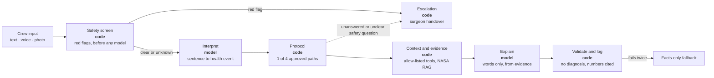
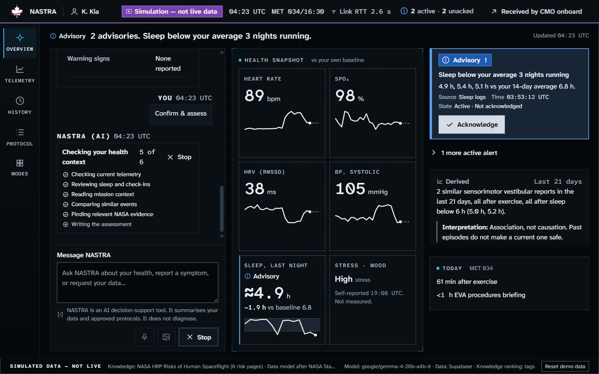
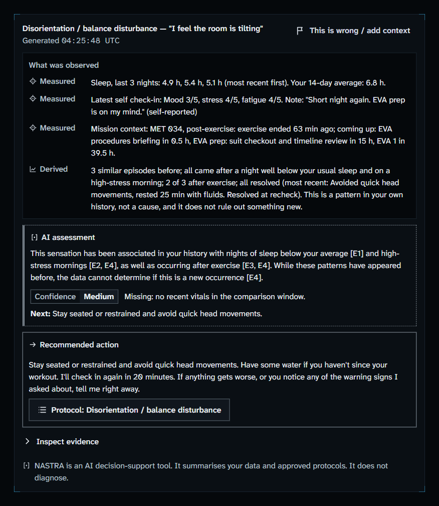
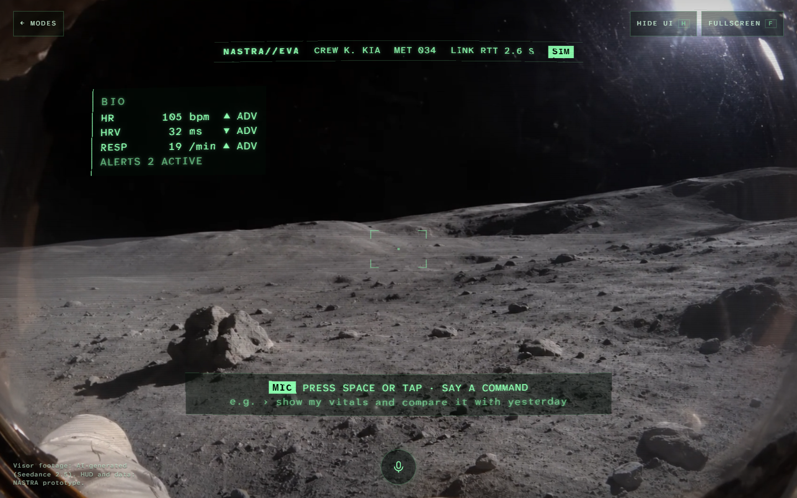
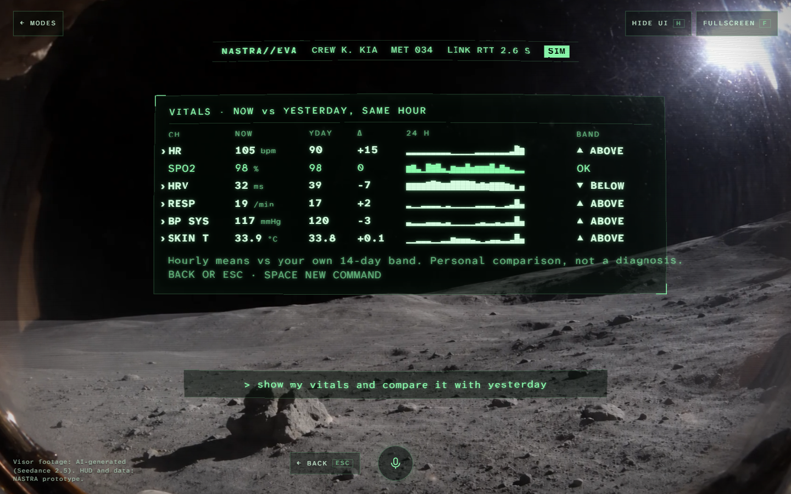
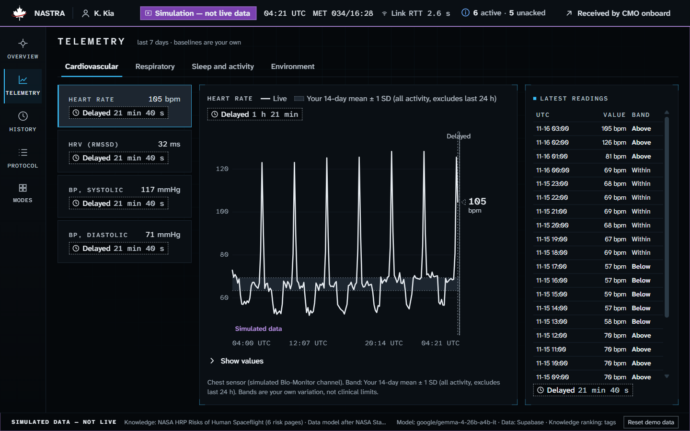

<div align="center">


# NASTRA

### Astronaut Intelligent Health Copilot

Health context that lives onboard, for when Earth is too far to answer in time.

[**Live demo**](https://nastra-kappa.vercel.app/) · [How it works](#one-sentence-seven-layers) · [How we built it](#how-we-built-it) · [Safety model](#safety-lives-outside-the-model) · [Run it](#run-it-locally)

Built by **Maple One** for the NASA Space Apps Challenge 2026

      


</div>

---

## "I feel the room is tilting."

A crew member says this on day 34 of a long mission.

On the ISS, a flight surgeon is a call away. On the way to Mars, they are not. A crewed Mars mission would last roughly three years, and every message to Earth comes back minutes later. Care that waits for a reply is care that arrives late.

The data to understand that sentence already exists. Heart rate, sleep, stress, the workout an hour ago, the EVA tomorrow, two similar episodes last month. It just lives in different places, and nothing joins it at the moment a symptom appears.

The signals exist. The context doesn't.

NASTRA is that missing layer. It connects body, mind, mission and history the moment something feels off, and it keeps every safety-critical decision out of the AI's hands.

> NASTRA is a concept prototype. It is not affiliated with, endorsed, approved or certified by NASA or CSA, and makes no claim of operational readiness. All crew data is simulated. It is not a medical device, and it does not diagnose or replace a flight surgeon.

---

## Two forms, one brain

NASTRA is prototyped in two versions to show how it would work in practice.

| | NASTRA Station | NASTRA EVA |
|---|---|---|
| Where | Software on the crew's onboard computer | A HUD projected on the helmet visor |
| How you use it | Conversation, voice, photos, a full health dashboard | Voice first, glanceable, exception-only |
| When | Daily life on the station | When hands and attention are busy |
| Underneath | The same safety screen, protocols, data and validator | The same safety screen, protocols, data and validator |


Everything on one screen. In a high-workload moment, nobody should have to scroll to find their heart rate.

---

## One sentence, seven layers

Here is what happens when the crew member says "I feel the room is tilting." The model touches two of the seven layers. Code runs the rest.



**1. The safety screen runs first.** A deterministic red-flag check reads the message before any AI sees it. "Hel", "can't breathe", "nearly fainted": these escalate straight away. Unknown is not treated as safe.

**2. NASTRA asks before it assumes.** Warning signs come first, at most two questions per turn, as quick replies that code resolves, not the model.


**3. It reads back what it understood.** When the input is unclear, the crew member sees NASTRA's understanding in their own words and confirms it. Nothing moves on a guess.

**4. It gathers context through a gateway.** Vitals, sleep, mood, mission schedule, past episodes and NASA knowledge come through an allow-listed tool gateway. Every call is logged, and the model never runs a query.



**5. It explains, and code checks the words.** The model writes a short explanation using only the evidence it was given, and code checks it before the crew sees it: no diagnosis, no false reassurance, no cause claimed, every number cited. If it fails twice, a facts-only answer goes out instead.

<p align="center"></p>

This is a real assessment from the live demo. The measured data, the derived pattern and the recommended action are written by code. Only the paragraph under "AI assessment" is the model's, and every claim in it points to evidence.

> "Similar dizziness followed exercise on earlier mission days, both after sleep below this astronaut's baseline."
>
> Association is not causation. A past benign episode never makes a new one safe.

**6. It escalates with a handover, not a notification.** When a warning sign appears, the flight surgeon gets a brief built in code: the trigger in the crew member's own words, flagged data with numbers, the full conversation, and the model's reading labelled unverified. The alert shows when it was sent and when it was received, after the real link delay (simulated).

**7. It stays with you after a warning.** After an escalation, NASTRA doesn't start over and doesn't repeat itself. It keeps the whole conversation, answers what you actually said, and shows one quiet line with the status of your alert.

---

## Safety lives outside the model

The LLM does not control the health system. The protocol engine controls the process, and the model communicates it.

- **Code decides, the model writes.** Routing, protocols, escalation and alert levels are deterministic and auditable.
- **Urgency can only go up.** Silence or confusion on a safety question escalates instead of asking again.
- **No invented thresholds.** Every comparison is against the crew member's own 14-day baseline, down to the same minutes after a workout.
- **The AI can never raise an Emergency.** The baseline monitor raises Advisories only (1.5 SD from your own baseline, or three short nights). Only deterministic escalation raises a Warning.
- **The camera describes, it never diagnoses.** A photo becomes neutral observations. Code removes anything that names a condition or an emotion, the crew ticks what is right, and the photo is never stored.
- **History never overrides now.** Similar past episodes add context, but never mark a new one as safe.

We tested this by pretending to collapse: "shortness in breath" became "im barely standing", then "hel". The first build asked the same safety question three times and nobody was notified. We fixed all four causes, and that conversation is now a permanent test.

---

## NASTRA EVA

For the moments when you can't look at a laptop. A mono-green HUD is projected onto the curved visor glass. It follows head movement and shows only what is out of the ordinary.



Tap the mic or press Space, and say "show my vitals and compare it with yesterday."

 

Six channels, now against the same hour yesterday, with the change, a 24-hour trend and your personal band. The numbers are live data from the same backend as Station. When there is no reading near the same hour yesterday, the cell stays empty instead of inventing a value.

The voice step is scripted for a controlled demo: one command with fixed timing. The visor footage is AI-generated (Seedance 2.5), and the HUD labels it on screen.

---

## How we built it

We built NASTRA in layers, and each layer answered one question. Here is the path, in the order we walked it.

### 1. Start from the mission

The question was never "what can an LLM do for astronauts?" It was: when a crew member feels something is wrong and Earth is minutes away, what do they need in that moment?

The answer was context. The physiology, the psychology, the mission schedule and the history, joined into one picture. The AI is the last piece, not the first.

### 2. Data first, honestly simulated

We have no astronaut data, and nobody outside a mission does. So we simulated it, and we say so on every screen.

The schema lives in Supabase (Postgres). 21 days for three crew members, modelled on the CSA Bio-Monitor channels: heart rate, HRV, SpO2, breathing, skin temperature, blood pressure, plus sleep, mood check-ins, mission events and cabin air. One deterministic generator, so the same anchor always produces the same mission.

Every read is a named SQL function: deviation from baseline, the comparison at the same minutes after exercise, the series, the transcript. Why SQL functions? They are auditable, they run the same in the cloud and offline (PGlite runs the identical migrations in-process for tests), and they give the model nothing to query directly.

### 3. A brain where the model fills a form

We split "understanding" from "deciding."

The model's first job is narrow: read one message and fill a fixed form. Speech act, domain, body system, symptoms, onset, severity, confidence, what's missing. Zod turns that form into a strict JSON schema, and anything off-schema is rejected.

Then code takes over. A router picks the action (answer, protocol, follow-up, escalate), and a protocol engine runs the approved steps. The model's second job is to write the explanation, from evidence that code already chose.

We first ran a small Qwen model (28 / 28 on our eval). We switched to Gemma 4 26B A4B because the hackathon asks for no China affiliation, and because Gemma is open weights. It is a mixture of experts: 26B parameters stored, about 4B active per token, so it runs close to a small model while understanding like a larger one. It reads images too, so one model covers text and photos.

### 4. The day it failed

We tested NASTRA by pretending to collapse. "Shortness in breath and shaking hands." Then "im barely standing." Then "hel."

It asked the same safety question three times, and nobody was notified. We found four causes: the safety screen knew "shortness of breath" but not "shortness in breath", it had no rule for near-collapse language or a bare call for help, an unanswered safety question was repeated instead of escalated, and escalation said it had alerted the surgeon without writing anything.

That day shaped the whole safety model. The red-flag screen now runs before any model call. Silence or confusion on a safety question escalates. Urgency can only go up. And the crew is told an alert was sent only after the database confirms it. That conversation is now a permanent test.

### 5. Grounded in NASA sources

The model is not allowed to rely on what it remembers. We took a dated snapshot of six NASA Human Research Program risk pages, split them into 18 chunks, and embedded them locally with gte-small through Transformers.js.

Retrieval filters by the tags the active protocol allows first, then ranks by vector similarity in pgvector. Why filter first? A dizziness protocol should only ever see vestibular and related evidence, however similar some other text looks. Every answer and every surgeon brief carries the source link. On our knowledge test, every query lands on the right risk page (7 / 7).

### 6. A handover, not a notification

The first escalation only said "answered yes to the warning-signs check." That is useless to a flight surgeon.

Now code builds the brief: the trigger in the crew member's own words, the complaint, flagged data with numbers (heart rate +16 against their own post-exercise usual, three short nights, stress 4 of 5, two past dizziness episodes, EVA in 40 hours), the full conversation, and the model's reading labelled unverified. Built in code, so an emergency handover never waits on an API or contains a guess.

### 7. A station you can read in one glance

NASTRA Station runs on NHIS, our own design system: React Aria for accessible primitives, Atkinson Hyperlegible for type, tokens with automated contrast checks. On top, a Spectre-style skin gives it the instrument-panel look: square corners, mono labels, HUD brackets. Cyan is used only for structure, so alert colours always mean alerts.

The rule was one screen, no scroll, from 1280 x 720 up. When space runs out, lower-value detail gives way first. The "association, not causation" caveat never does. Every page passes axe-core WCAG 2.2 AA with zero violations, including mid-escalation.

### 8. Bugs only real runs could find

Some of our best fixes came from using it, not from testing it.

A heart-rate tile once showed "0 bpm, -69 vs baseline." In JavaScript, `Number(null)` is 0, so an empty comparison window read as zero. Worse, that zero would have reached the model as evidence. We fixed it at the source.

Dashed frames started appearing at random. They were honest "delayed data" markers: the seed stops at the moment of reset, so ten minutes later every reading really was old. Our offline checks never aged the data. The fix was a deterministic simulated feed that extends readings every 150 seconds, labelled as simulated.

And after a Warning, NASTRA once forgot the emergency and asked "is this physical, emotional or data?" Then, fixed too rigidly, it repeated the same banner every turn. Now it keeps the escalated event and the last ten turns in context, answers what you actually said, and shows one quiet status line.

### 9. Photos that describe, never diagnose

A face photo first returned nothing, because we only read device screens. Now the model describes what is visible ("left eye: redness in the white of the eye"). Code removes anything that names a condition, a cause or an emotion. The crew ticks what is right before it joins the message, and the photo is never stored.

### 10. EVA: the same brain, a different moment

On a spacewalk you can't read a dashboard. So we asked what the minimum useful display is: what's out of the ordinary, and a voice to ask for more.

The visor scene is cinematic footage (AI-generated, and labelled as such) drawn on a canvas with a bounded look-around. The HUD is real DOM on a plane that shares the footage's transform, clipped to the visor opening and bent by an SVG displacement map so the text sits on the curved glass. No 3D engine was needed. The data behind it comes from the same API as Station.

### 11. Shipping it

NASTRA deploys to Vercel straight from this repo, with data on Supabase. Keys stay server-side. The browser never touches the database, row level security blocks the browser roles, and only named functions are callable.

---

## The numbers

| Check | Result |
|---|---|
| Message understanding eval (Gemma 4 26B A4B) | 28 / 28 |
| Safety screen eval: every emergency escalates before the model is called | 28 / 28 |
| NASA knowledge retrieval: every query lands on the right HRP risk page | 7 / 7 |
| Automated tests, including replays of real failed chats | 108 passing |
| Accessibility, axe-core WCAG 2.2 AA on all 6 pages | 0 violations |
| Simulated mission data | 21 days, 3 crew, live feed every 150 s |
| Protocols | 4 (sensorimotor, behavioral health, general physical, red-flag response) |



---

## NASA and CSA resources

| Resource | How NASTRA uses it |
|---|---|
| [NASA HRP, Risks of Human Spaceflight](https://www.nasa.gov/hrp/risks/) | Six risk pages ingested, searched live and cited in every answer and in the surgeon brief |
| [NASA, 5 Hazards of Human Spaceflight](https://www.nasa.gov/hrp/hazards/) | Mission-context framing, and the Earth link delay shown in every escalation |
| [NASA, Ongoing HRP Research](https://www.nasa.gov/hrp/ongoing-hrp-research/) | Precedent for long-duration crew health work |
| [CSA, Monitoring radiation for astronaut health](https://www.asc-csa.gc.ca/eng/news/articles/2026/2026-02-26-monitoring-radiation-astronaut-health.asp) | Radiation as mission context |
| [CSA, Why do we conduct science experiments in space?](https://www.asc-csa.gc.ca/eng/iss/science/why-do-we-conduct-science-experiments-in-space.asp) | Long-mission framing |
| CSA Bio-Monitor | The channel model behind the simulated vitals |
| NASA-STD-3001, OCHMO Longitudinal Health Surveillance | Logging and handover design |
| NISTIR 7804 | Crew identification is always visible |

The full map of sources lives in the project docs.

---

## Built with

| Layer | Technology |
|---|---|
| App | Next.js 16 (App Router), React 19, TypeScript, Zod 4 |
| Model | Gemma 4 26B A4B (Google, open weights, Apache 2.0) via OpenRouter, behind one OpenAI-compatible interface, so going local (for example Ollama) is a config change |
| Local ML | Transformers.js: Whisper tiny.en for speech-to-text, gte-small for embeddings |
| Data | Supabase (Postgres, pgvector, RLS, SQL read models); PGlite for offline runs and tests |
| Design system | NHIS, our own: React Aria, Atkinson Hyperlegible, design tokens with contrast checks, a Spectre-style FUI skin |
| EVA | Canvas 2D, HTML5 video, SVG displacement map, CSS clip-path |
| Quality | Vitest, Playwright, axe-core |
| Hosting | Vercel, auto-deployed from this repo |

Why Gemma: open weights can run onboard with no ground link, the active compute is small (about 4B parameters per token), and one model reads both text and photos. The same family has suit-sized versions, which gives NASTRA EVA a path to real hardware.

---

## Run it locally

You need Node.js 20 or newer.

```bash
git clone https://github.com/KiyarashKia/Nastra.git
cd Nastra/Product
npm install
```

**Fastest: fully offline.** No keys, no database. It uses an in-memory Postgres and a stub model, so the UI and the deterministic engines all run, and the model's words are placeholders.

```bash
NASTRA_DB=pglite NASTRA_LLM=stub npm run dev
```

On Windows PowerShell: `$env:NASTRA_DB="pglite"; $env:NASTRA_LLM="stub"; npm run dev`

**Full stack.** Create `Product/.env.local`:

```bash
OPENROUTER_API_KEY=...
SUPABASE_URL=...
SUPABASE_SECRET_KEY=...           # server-only, never exposed to the browser
NASTRA_MODEL_INTERPRET=google/gemma-4-26b-a4b-it
NASTRA_MODEL_RESPOND=google/gemma-4-26b-a4b-it
```

Apply `Product/supabase/migrations` in order, then load the NASA knowledge and start:

```bash
npm run ingest      # embeds the NASA HRP snapshot locally and stores it
npm run dev         # open http://localhost:3000, then press "Reset demo data"
```

Useful scripts:

```bash
npm test            # 108 tests, no network
npm run eval        # model understanding eval
npm run surgeon     # simulated ground console: read and answer escalations
```

Then try it: open NASTRA Station and type "I feel the room is tilting." For the warning path, answer "Nearly fainted."

---

## Repository

```
Nastra/
  Product/                the working prototype (Next.js)
    src/nastra/           the brain: safety, interpret, router, protocols, tools, respond, validate
    src/ui/               Station and EVA interfaces
    supabase/migrations/  schema, read models, simulation, live feed
    knowledge/            dated NASA HRP snapshot
    tests/  eval/         tests and the model eval set
  NHIS/                   NASTRA Human Interface System, our design system
  docs/media/             screenshots used in this README
```

---

## Honest limits

- All crew data is simulated, labelled on every screen, and modelled on CSA Bio-Monitor channels. Going live means replacing the simulated feed behind the same tools.
- The red-flag list was written by the team for this prototype. A flight surgeon would need to review it before any real use.
- The EVA voice flow is scripted, and its visor footage is AI-generated.
- Whisper and local embeddings run on a local machine. On the hosted demo, knowledge search falls back to tag ranking and Station voice may be unavailable.

## What's next

Ingest the other challenge resources directly, validate against NASA Standard Measures, and move inference onboard with a local Gemma.

---

<div align="center">

**Maple One** · Kiarash Kia · Upayan Chatterjee

NASA Space Apps Challenge 2026 · [MIT License](LICENSE)

When Earth is out of reach, care can't wait for a reply.

</div>
